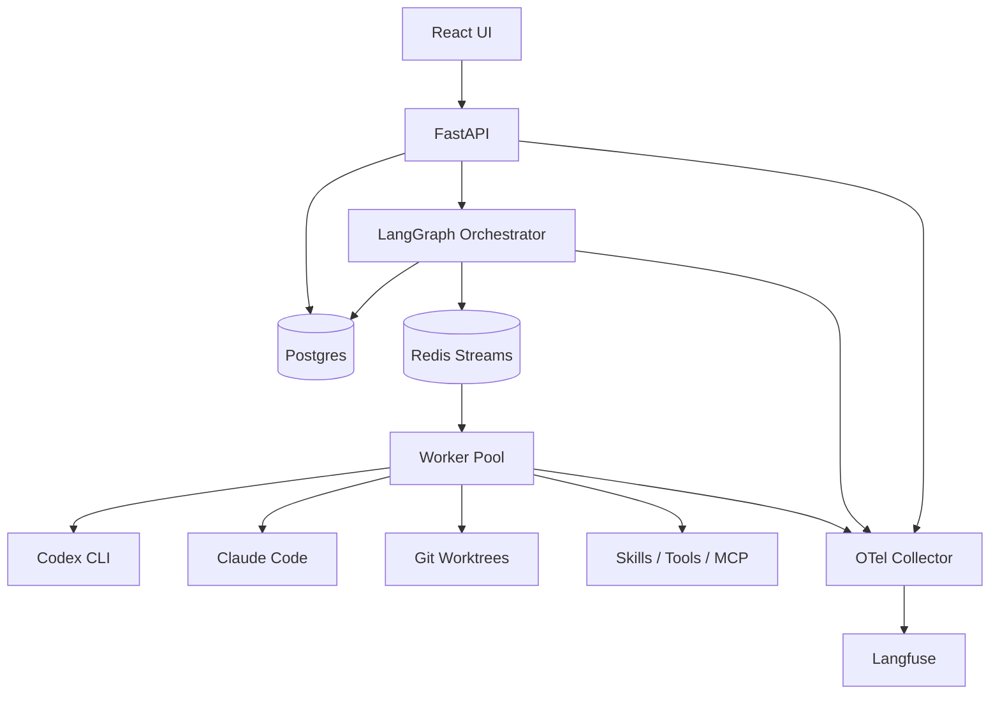

# AI Development Factory — MVP Specification
Version 0.2, October 11, 2026 — Windows 11 / WSL2 / Docker Desktop deployment profile

## Goal
A local, single-user development factory: manual task creation and goal decomposition, autonomous parallel agent execution, testing, review, Git branches and commits. Four equally important priorities: an end-to-end pipeline, extensibility, UI/monitoring, and parallelism.

## Stack
React, TypeScript, React Flow, TanStack Query; Python FastAPI, Pydantic, SQLAlchemy, Alembic; LangGraph (orchestration and checkpoints), LangChain (supported tools/models), Codex and Claude Code CLI adapters; PostgreSQL, Redis Streams; OpenTelemetry Collector, Langfuse; Docker Compose.

## Key Architectural Decisions
1. A shared local repository and root workspace, with **a separate Git worktree for each parallel task**. Concurrent writes to the same worktree are prohibited.
2. Microservices: frontend, API, orchestrator, worker pool; infrastructure: PostgreSQL, Redis, OTel Collector, and a separate official Langfuse stack (with its required dependencies, including analytical and object storage).
3. CLIs are not LangChain models: use separate subprocess adapters, event normalization, and session, timeout, and cancellation management.
4. The React Flow editor saves a versioned declarative JSON DAG, validated by the backend and compiled into supported LangGraph nodes. Arbitrary code from the UI is not executed.
5. Subscription-based CLIs: verify the applicable provider terms; usage reporting and financial limits are not guaranteed to be available. Enforce strict limits on time, concurrency, steps, and attempts.
6. MVP CLI runtime: **a host worker in Ubuntu WSL2**, with local CLI authentication. All other services run in Docker Compose. A containerized CLI worker is outside the MVP scope; do not copy secrets into the database.

## Diagram


## Domain Model
Project(id,name,repo_path,default_branch,config); Task(id,project_id,parent_id,title,description,acceptance_criteria,status,priority); TaskDependency(task_id,depends_on_id); AgentDefinition(id,name,role,provider,prompt,skills,tools,mcp_servers,limits); WorkflowDefinition(id,name); WorkflowVersion(id,workflow_id,version,graph_json); WorkflowRun(id,workflow_version_id,task_id,thread_id,status); NodeRun(id,run_id,node_id,attempt,status,lease_id); Execution(id,node_run_id,worktree,branch,cli_session_id,exit_code,usage); Artifact(id,run_id,kind,path,checksum); GitChange(id,task_id,branch,commit_sha,base_sha,status); Event(id,run_id,type,payload,time); Policy(id,limits,permissions); Skill(id,version,path,manifest); McpServerDefinition.

Task statuses: draft, ready, blocked, running, review, done, failed, cancelled. Run statuses: queued, running, paused, completed, failed, cancelled. Transitions are validated by the server.

## Workflow
MVP nodes: start, planner, agent_task, condition, parallel_fork, parallel_join, test, review, git_commit, end. Support bounded retries; approval is a minimal blocking node for policies. The graph is acyclic; require one start, a reachable end, and validation of ports, types, fork/join, and the maximum node count. Support versioning; running instances use an immutable version.

**Main scenario:** create a task/goal → the planner returns structured subtasks, dependencies, criteria, and expected files → validate the DAG → the scheduler selects independent ready tasks → create separate worktrees/branches `factory/<run>/<task>` from a fixed base SHA → a CLI agent modifies code → tests → review → bounded retry on failure → commit → the integrator sequentially applies changes to `factory/<run>/integration` → integration tests → artifacts and final status.

Dependent tasks do not start until their dependencies have completed successfully. Overlapping files are a reason to serialize work; potential conflicts discovered later are handled during integration. Do not automatically merge into main. On conflict, make a bounded resolution attempt, then set `needs_resolution`.

## Agent System
Default roles: Planner, Architect, Developer, Tester, Reviewer, Integrator. Each agent has a role, system prompt, CLI provider, model parameters, skills, tools, MCP, and limits. Skills are versioned local directories with a manifest; tools use a typed registry and JSON Schema; MCP uses an allowlist of trusted servers and tools, with time limits and restrictions on access to secrets. CLI capabilities differ; adapters must explicitly declare their capabilities.

Adapter interface: start(context,prompt,limits), stream(handle), cancel(handle), collect_result(handle), healthcheck(). Normalized events: session_started, message, tool_call, tool_result, usage, warning, error, completed. Store CLI versions, exit codes, and raw logs with secrets redacted; support child process cancellation, timeouts, and log size limits.

## Reliability and Parallelism
Redis Streams consumer groups and leases with heartbeats; Postgres is the source of truth. Use LangGraph Postgres checkpoints for graph recovery. Idempotent commands, a unique execution_id, persisted base SHA/commit SHA, and reconciliation after restart. External CLI execution must not be treated as atomic. Pause stops dispatching new tasks; cancel interrupts active processes. The scheduler limits concurrent tasks per project and provider.

## Security and Limits
Initial settings (configurable): max_parallel_agents=3; max_tasks_per_plan=12; max_retries=2; max_execution_minutes=30; max_run_minutes=180; max_output_mb=20; max_disk_gb_per_run=5. Limit available CLI turns where supported. Display tokens and costs only when the provider supplies reliable data; otherwise use `unknown`.

Bind the API only to 127.0.0.1; use a local admin token, CORS/Origin checks, and CSRF protection with cookie authentication. Isolate write paths, protect `.env`/keys, filter logs and telemetry, validate skills and MCP, and prohibit dangerous shell commands and force-push. Do not enable unrestricted permission bypass by default. The host worker runs with minimal privileges under a separate OS user, since this mode does not provide full container isolation.

## API
GET/POST /api/projects; GET/POST /api/tasks; POST /api/tasks/{id}/decompose; GET/POST/PATCH /api/agents; GET/POST /api/workflows; POST /api/workflows/{id}/versions; POST /api/workflows/{id}/validate; POST /api/runs; GET /api/runs/{id}; POST /api/runs/{id}/pause, /resume, /cancel; GET /api/runs/{id}/nodes, /events (SSE), /artifacts, /git-changes; GET/POST /api/skills, /mcp-servers; GET /api/providers/health; GET /api/metrics/overview; GET /healthz, /readyz.

OpenAPI/Pydantic schemas, pagination, an idempotency key for run creation, and a unified error format `{code,message,details,request_id}`.

## UI
1. Dashboard: projects, runs, queues, agents, errors, metrics.
2. Projects: local repository, branches, test commands.
3. Tasks: list/kanban, dependency DAG, criteria, decomposition.
4. Workflow Editor: React Flow, node drag/drop, settings, validation, versions, launch, execution highlighting.
5. Agents: roles, prompts, providers, skills/tools/MCP, limits, CLI checks.
6. Run Detail: parallel branches, statuses, realtime events, pause/resume/cancel.
7. Execution Detail: CLI event stream, tool calls, errors, usage, trace link.
8. Git Changes: branches, commits, diff, tests, integration conflicts.
9. Settings: local paths, limits, policies, telemetry.

## Observability
OpenTelemetry spans: api.request, workflow.run, workflow.node, agent.execution, cli.session, tool.call, git.operation, test.run. Correlation IDs: project_id, task_id, run_id, node_run_id, execution_id, agent_id, provider. Langfuse handles agent/LLM traces and evaluations; OTel transports system telemetry. Do not export duplicate spans. Metrics: duration, success rate, retries, queue depth, concurrency, conflicts, test pass rate, available usage data. Do not send secrets or sensitive code to traces by default.

## Nonfunctional Requirements
At least 3 parallel independent executions. Target UI event latency below 2 seconds. Preserve state and artifacts when containers are recreated. After restart, restore checkpoints and reconcile unfinished runs. Docker Compose with volumes, migrations, and healthchecks. Unit/integration/E2E tests and a mock CLI for testing without subscriptions. Log rotation and backups of the database and artifacts.

## Implementation Stages
**E1. Foundation:** Compose, FastAPI, React, PostgreSQL, Redis, healthchecks, migrations, project/task CRUD.
**E2. Runtime:** Codex/Claude adapters, mock adapter, worker, event streaming, Git worktrees and commits.
**E3. Orchestration:** LangGraph, planner, DAG scheduler, parallel fork/join, checkpoints, retries, integration branch.
**E4. UI:** visual workflow editor and versions, agent editor, realtime run monitor, Git diff.
**E5. Observability/security:** OTel/Langfuse, limits, allowlists, MCP/skills, recovery, E2E, and documentation.

## Acceptance Criteria
A1. Local startup through documented commands; the CLI healthcheck works.
A2. The user creates a project and a task, or a goal is automatically decomposed into a DAG.
A3. Workflows can be created/edited/validated in the UI; runs are tied to a version.
A4. Three independent tasks actually execute in parallel in separate worktrees; dependencies are respected.
A5. Codex and Claude CLIs are available through a common contract and can be selected for agents.
A6. Agents produce changes and Git commits in task branches; the integrator creates a separate final branch.
A7. Tests and review record their results; integration conflicts do not damage main.
A8. Pause/resume/cancel, retries, timeouts, and recovery are verified by automated tests.
A9. Skills/tools/MCP are assigned to agents with allowlists and auditing.
A10. The UI displays realtime events and links to Langfuse traces; OTel correlation IDs are linked.
A11. Concurrency/time/attempt limits are enforced; unknown usage is not replaced with an estimate.
A12. Secrets do not appear in API responses, CLI logs, or telemetry in typical test scenarios.

## Confirmed Decisions and Open Questions
- Target environment: Windows 11 + WSL2 Ubuntu + Docker Desktop (WSL integration enabled).
- CLI runtime: WSL2 host worker, outside Docker Compose.
- Repositories and worktrees: ext4 inside WSL2, not `/mnt/c`.
- To what extent automatic conflict resolution is acceptable (default: a bounded attempt, without merging into main).
- Whether to use a single shared UI for system metrics or link to the standard Langfuse interface (preference: a brief overview + deep links).

## Documentation Links
- LangGraph persistence: https://github.com/langchain-ai/docs/blob/main/src/oss/langgraph/persistence.mdx
- Langfuse self-hosting: https://langfuse.com/self-hosting
- Langfuse SDK / OpenTelemetry: https://langfuse.com/docs/observability/sdk/overview
- Claude Code CLI: https://docs.anthropic.com/en/docs/claude-code/cli-usage


---

## Windows 11 + WSL2 + Docker Desktop Deployment Profile (Mandatory, v0.2)

### Environment Separation and Trust Boundaries

- **Windows host:** Docker Desktop with the WSL2 backend; browser for the React UI; VS Code Remote WSL (optional). Do not run the Windows CLI version concurrently for the same sessions.
- **Ubuntu WSL2:** Node.js, Codex CLI, Claude Code, Git, Python/uv; local CLI credential stores; source repositories and worktrees; the Python `runtime-worker` process running as a regular unprivileged Linux user.
- **Docker Compose:** `frontend`, `api`, `orchestrator`, `postgres`, `redis`, `otel-collector`, and the official self-hosted Langfuse stack with its own dependencies. Do not include the host CLI worker in Compose.
- **Network:** expose API/UI on Windows/WSL loopback. Publish PostgreSQL/Redis only on `127.0.0.1` for the host worker; use separate accounts and passwords. Verify Docker Desktop/WSL2 networking with a smoke test: `127.0.0.1` availability may depend on configuration; if unavailable, document an explicitly configured gateway address instead of exposing ports on `0.0.0.0`.
- **Secrets:** CLI credentials stay in the WSL home directory, are not mounted into containers, are not logged, and do not reach Langfuse. Run the CLI under the same Linux user that performed the interactive login.

### CLI Runtime Worker: Responsibilities and Contract

`runtime-worker` is a separate Python package/process launched in Ubuntu WSL2 (`uv run ...` or user-level systemd, if systemd is enabled). It receives jobs from Redis Streams through a consumer group, registers its heartbeat and capabilities, runs local CLIs, and publishes structured events. On startup, it checks `git`, `codex`, `claude`, paths, and backend availability. The UI shows each CLI's health independently.

**Flow:** FastAPI creates a run in PostgreSQL → the orchestrator persists a node execution → durable outbox → Redis Streams → the WSL worker claims the job → creates/validates a worktree → launches the CLI → writes events/artifacts → commits after successful validation → reports terminal status → the orchestrator advances the DAG. Redis Streams is the transport; PostgreSQL is the source of truth. Delivery is at-least-once, so an idempotency key, lease, and deduplication are mandatory. After a worker crash, reconcile stuck tasks and worktrees.

**Adapters:** `CodexAdapter`, `ClaudeAdapter`, `MockAdapter` with a common interface: `probe()`, `execute(request, event_sink, cancellation)`, `cancel()`, `collect_usage()`. Request schema: `execution_id`, `agent_config_version`, `workspace_path`, `task_prompt`, `allowed_tools`, `timeout_sec`, `max_steps`, `git_branch`, `env_allowlist`. Events: `started`, `output`, `tool_started`, `tool_finished`, `usage_reported`, `heartbeat`, `completed`, `failed`, `cancelled`. Do not assume CLI JSON/stream stability without adapter contract tests: pin and verify CLI versions and flags.

**Subprocess execution:** `cwd` = the specific worktree; `shell=False`; arguments as an array; a restricted environment; a separate process group for terminating child processes; cap stdout/stderr size and redact secrets; timeout, cancellation, and kill escalation. Do not run CLIs with unrestricted `--dangerously-skip-permissions` / equivalents by default. For autonomous mode, provide an explicitly selected permission profile, risk acknowledgment, and a restricted command allowlist. No global `sudo`, Docker socket access, or arbitrary MCP servers without an allowlist.

**Subscriptions and limits:** the user authenticates separately in Codex CLI and Claude Code in WSL; the CLI adapter does not store passwords. Support for subscription use and available noninteractive modes depends on current provider terms/capabilities; provide a mock fallback and an `AUTH_REQUIRED` error. `max_wall_time`, `max_parallel_jobs`, `max_retries`, `max_tool_calls` (only if measurable), `max_output_bytes`; financial limits cannot be considered strict if the CLI does not report reliable usage.

### Git Worktrees and Parallel Development

Root directory structure (example):

```text
/home/<user>/ai-factory/
  projects/<project-slug>/repo/        # main Git checkout
  worktrees/<project-id>/<execution-id>/
  artifacts/<run-id>/
  logs/                                 # no secrets
  config/
```

Projects must use local Linux paths, canonicalized and verified to be within allowed roots. The MVP may use one shared repository, **but not one directory for concurrent writes**. Each execution that modifies code gets a unique worktree and branch `factory/task/<task-id>/<execution-id>` from a fixed base SHA. Only one writer per worktree; a reader/reviewer may read a snapshot. An agent cannot write directly to the main checkout.

Workflow: (1) pin the base commit; (2) `git worktree add -b ...`; (3) verify a clean state; (4) run the CLI in the worktree; (5) run allowlisted checks; (6) `git status`/diff and a secrets check; (7) create a commit with task/execution metadata; (8) the integrator sequentially applies commits to a separate `factory/integration/<run-id>` branch through cherry-pick; (9) test the combined result; (10) leave the original `main` untouched. Conflict → `INTEGRATION_CONFLICT` status, a log of conflicting files, and at most one bounded automatic repair attempt in a separate worktree; then manual resolution.

Cleanup: remove a worktree only after terminal status and confirmed preservation of the commit/artifacts; on failure, run `git worktree list --porcelain` and reconcile; **do not** blindly run `git worktree prune` for active tasks. Protection against duplicate execution: idempotency + a PostgreSQL lock on `execution_id` and a lease, branch naming, and a check for an existing commit.

### Docker Compose: Logical Services and Networking

Minimum repository structure:

```text
infra/compose.yaml
infra/compose.langfuse.yaml
infra/otel-collector.yaml
services/api/
services/orchestrator/
services/runtime-worker/   # runs in WSL, NOT a Compose service
frontend/
packages/contracts/
scripts/bootstrap-wsl.sh
scripts/doctor.sh
```

Compose must include `healthcheck`, a restart policy, named volumes, pinned image versions, `env_file` without committed secrets, and database migrations before API/orchestrator startup. `postgres` and `redis` may have loopback-bound host ports for the WSL worker; UI/API must also bind to loopback. Set explicit `depends_on: condition: service_healthy` where appropriate, but do not treat it as a replacement for client retries. Deploy Langfuse using the supported official Compose configuration, accounting for current dependencies (including ClickHouse, object storage, and queue/cache as required by the version), and do not replace them with a custom lightweight setup without verifying compatibility. Langfuse resource requirements may be substantial: provide an `observability` profile and support running the core system without it, with exporter buffering/disabling.

**Network interfaces:** REST/WebSocket UI→API; API/orchestrator→Postgres/Redis; WSL worker→Redis and API (as needed); all services→OTel Collector through the internal Compose network, and WSL worker→Collector through a separate loopback-bound OTLP port. Do not send full prompts, source code, env vars, or stdout to telemetry by default. Use consistent `trace_id`, `run_id`, and `execution_id` values.

### Initial Startup Sequence

1. Verify Windows 11, `wsl --status`, `wsl -l -v` (Ubuntu on WSL2), Docker Desktop WSL integration, and `docker compose version` inside Ubuntu.
2. Create the project in `/home/<user>/ai-factory`; install Git, Node LTS, Python/uv, Codex CLI, and Claude Code in Ubuntu following official instructions; verify the commands and authenticate each CLI interactively.
3. Configure `.env` from `.env.example`, generate local secrets, and do not add `.env` to Git.
4. `docker compose -f infra/compose.yaml up -d --build`; run migrations and `scripts/doctor.sh` (DB, Redis, API, OTel, loopback port availability).
5. Start `runtime-worker` from Ubuntu and check `probe` for both CLIs. Run a mock workflow without external models.
6. Create a test Git repository and launch 3 independent tasks; verify three worktrees, three branches, and no overlapping writes.
7. Run the integration stage; verify commits, test results, UI events, and recovery after stopping the worker and restarting Compose.

### MVP Operational Constraints and Security

- The WSL2 filesystem is the source of truth for Git; back up PostgreSQL volumes, `/home/.../projects`, worktrees/artifacts, and configuration, excluding credential stores from ordinary archives or backing them up separately with protection.
- The CLI Worker is a trusted host process with access to the user's files: a Git worktree **is not a security sandbox**. Full isolation of arbitrary commands is not provided; untrusted repositories and autonomous shell commands require a separate sandbox strategy before production-like use.
- Do not pass secrets to agents unless explicitly necessary; MCP tools use allowlists and scoped permissions; protect against prompt injection in repository contents; prohibit dangerous commands through policies and restrictions on available tools (do not consider a textual prohibition in a prompt sufficient protection).
- Observability: separate agent events from system traces, redact secrets, limit log retention, and provide an option to disable Langfuse telemetry.
- Update Docker Desktop/WSL and CLI versions separately; run adapter contract tests after updates.

### Additional Environment Acceptance Criteria

- **W1:** `doctor.sh` detects WSL2, Docker Compose, Linux Git paths, CLI versions, and successful authentication without displaying tokens.
- **W2:** When Docker Compose restarts, the running host worker reconnects; jobs are neither lost nor committed twice.
- **W3:** Forcibly terminating a CLI terminates the entire process group, releases/reconciles the lease, and leaves the worktree usable for diagnostics.
- **W4:** Three parallel CLI processes use different `cwd` values and branches; `main` remains unchanged.
- **W5:** No container mounts the Codex/Claude credential home directory or `/var/run/docker.sock`.
- **W6:** Infrastructure ports are inaccessible from outside the host in the standard configuration, verified by a test rather than solely by the Compose declaration.
- **W7:** An integration conflict does not damage the original task branches or modify `main`.
- **W8:** The UI and tracing show end-to-end `run_id`/`execution_id` values from task submission to Git commit.

### Deferred Beyond the MVP

Per-agent container sandbox isolation, a secure Docker executor for tests, multi-user authentication, Kubernetes, remote workers, full Windows-native/macOS support, PR/CI integrations, and guaranteed financial cost control for subscription-based CLIs.
