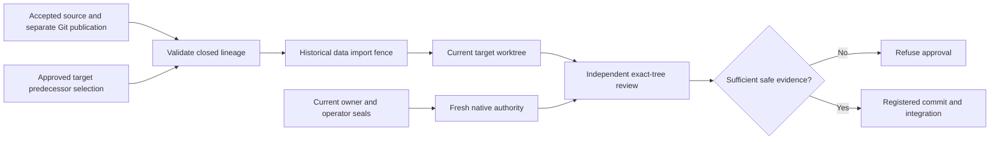

# ADR 010: Accepted historical commits are data, not native authority

Status: accepted for historical data validation, October 13, 2026. Historical
source-body projection and complete dependent native review remain unaccepted.

## Context

A task can depend on commits accepted in an earlier run/provider generation.
Reactivating retired native receipts would cross the execution authority boundary;
requiring the old receipt to be current prevents ordinary accepted-data reuse.

## Decision

Validate historical data through the source writer's immutable request, passing
tree-bound checks, independent review, exact Git tree and separately confirmed
durable publication. Match approved target predecessor selection, project/repository,
parent/trailers and original allowed paths. Reject ambiguity, unpublished or tampered
sources. Retain only a validation-only artifact-import fence. The current owner
supplies fresh native authority under unchanged operator seals and existing guards.

## Consequences and unresolved projection

Accepted data is reusable after owner restart without replaying old executions or
forwarding grants. Distinct duplicate successful publication journals are refused;
retransmission to the same journal is supported. Native review remains independent
and may refuse incomplete evidence: the two bounded runtime windows did so.

Arbitrary historical source-text projection is not adopted. Its unreviewed change
failed two confidentiality review cycles and the one additionally authorized cycle. A possible structural alternative withholds
raw source and emits only a closed evidence schema; insufficient evidence must still
refuse approval. That alternative is a proposal, not a verified implementation or
permission to weaken confidentiality, tooling or exact-tree review.

See the worker [lineage contract](../../services/runtime-worker/docs/accepted-commit-lineage.md)
and [observed checkpoint](../accepted-commit-lineage-checkpoint.md).

## Final structural cycle checkpoint

The additionally authorized strict literal-source cycle is not adopted: overall
verification failed and no candidate source was installed or published. The 102-case
synthetic matrix is bounded evidence, not a universal secrecy proof; Linux mypy also
rejects a comment that it interprets as a type annotation. Fresh Docker/API/Redis
availability is separately confirmed and does not waive the review/context gate.
Continue refusing approval for missing/withheld evidence. Omitting raw source and
using a closed metadata/check schema with opaque file IDs and no unrestricted path
strings remains a proposed safer design requiring review. Git framing and exported
path strings independently disclose protected synthetic literals with completeness
true in the final candidate; the candidate is rejected.
