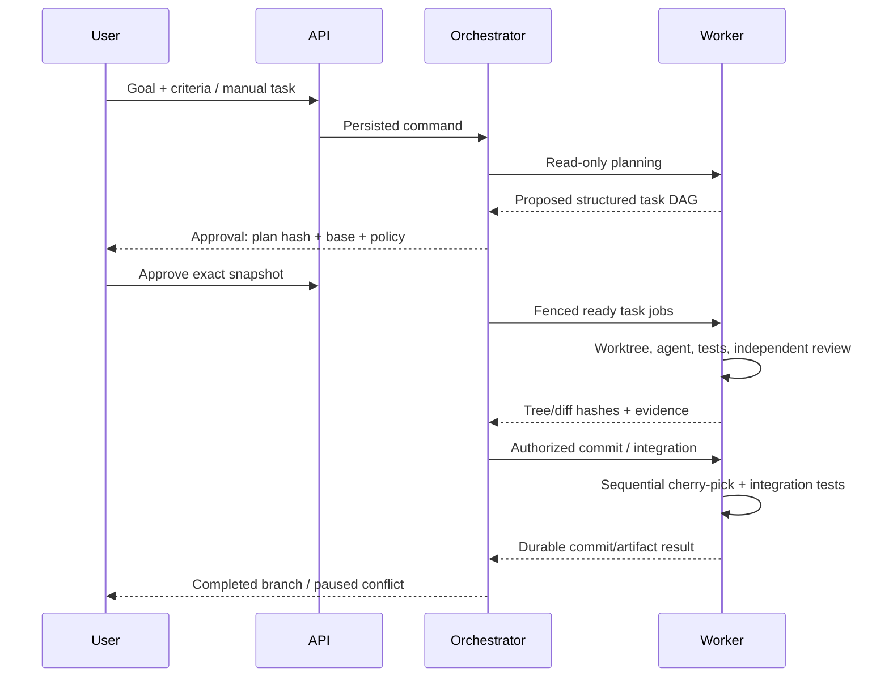

# Workflow and human approval

## Graph contract

Versions contain schema/node IDs/types/configs/typed ports/edges. Require one start/end, unique IDs, all nodes reachable from start and able to reach end, no cycles, compatible ports, deterministic conditions and paired nested fork/join structure. Default max 100 nodes and 12 planned tasks. Reject unknown types and arbitrary UI Python/JS/shell expressions. Conditions use a typed operator registry.

Nodes: start, planner, agent_task, condition, parallel_fork, parallel_join, test, review, approval, git_commit, end. Integration is a registered post-task phase. Retry wraps runtime nodes; UI DAG stays acyclic. Fork branches use separate state namespaces/deterministic reducers; all selected branches must succeed to join. Unselected branches are skipped, failures never count as success.

## Agent roles

Planner emits schema-validated tasks/dependencies/criteria/paths/unknowns; Architect refines read-only constraints; Developer writes one task; Tester runs registered commands; Reviewer assesses exact tree/diff independently; Integrator applies accepted deltas. A role does not imply unrestricted tools.

Every run pins prompt/config/policy/skill manifest hashes, tool registry/MCP revisions and provider capability/version records. Declare streaming, cancellation, resume, structured output, usage and enforceable tool limits. Reject missing required capabilities. Do not silently change paid provider or permissive mode. Canonical adapter interface is `probe`, `execute(request,event_sink,cancellation)`, `cancel`, `collect_usage`.

## Approval

Approval stores action type, run/node, request revision, plan/diff hash, base/tree SHA, policy version, requested paths/tools/network and expiry. Compare-and-swap applies one decision; changed content/permissions invalidates approval. Expiry pauses and never grants consent. Reject cancels the affected pending action; changed plans start new immutable snapshots.

Initial bounded execution approval may preauthorize local task commits/integration for trusted work. Expanded scope/new MCP/skills or optional conflict repair requires a new approval. Default-branch merge, push, credential export and external messaging are unavailable MVP actions. Provider permission denial is `PERMISSION_DENIED`, never a reason to add bypass flags.

Use JSON-safe LangGraph interrupts and same thread ID to resume. Resumed nodes restart; no untracked side effects before interrupt. API validates decisions independently of optional typed interrupt support.

## Git operations

Check canonical cwd/branch/base before spawn. Worker owns authoritative commit, validates test/review/policy results and stages reviewed paths only after index secret checks. Unexpected Git hooks/config must be inspected; a trusted policy can explicitly permit per-command hook suppression, never global changes. Preserve required signing policy. Never blindly stage generated target files.

Commit trailers identify run/task/execution; persist SHA before reporting. Failure preserves worktree without committing. Integration is serial in a unique branch. Default repair is manual; at most one isolated automatic attempt can be policy-approved. Cleanup requires terminal state, dead process and persisted artifacts/commits. Default branch remains untouched.
