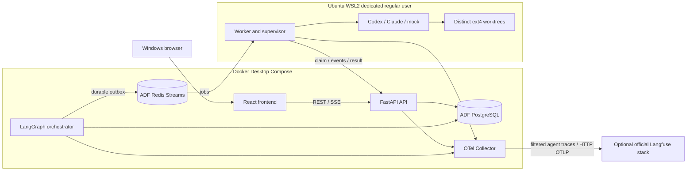

# Architecture and ownership

| Unit | Owns | Excludes |
| --- | --- | --- |
| frontend | Drafts, server-state cache, DAG rendering, approvals, cursors | Execution, secrets, authoritative success |
| api | Auth/validation/policy, CRUD, command intake, execution persistence facade, SSE/artifacts | Subprocesses, autonomous scheduling |
| orchestrator | Leader, compiler/checkpoints, scheduling, outbox, reconciliation, integration ordering | Filesystem execution, CLI credentials |
| runtime-worker | Probes, fenced supervisor, worktrees, subprocesses, checks/diffs/commits/uploads | Graph editing, approval authority, direct DB access |

Integrator/tester/reviewer are roles and registered operations, not separate services. Orchestration is a long-lived independently restarted process; API is the control surface. Shared PostgreSQL uses explicit schemas/role grants, not competing business-rule implementations.

Commands persist transactionally before API returns. Orchestrator pins `workflow_version_id` and LangGraph `thread_id=run_id`, records execution intent before Redis publication. Worker claims through internal API, which atomically checks owner/lease epoch/control state for every mutation. Redis is transport, PostgreSQL authority. Terminal/old delivery is acknowledged after a durable no-op decision. Outstanding DB intents reconstruct lost queues.

## Filesystem and dependency boundaries

Foundation source stays in the requested Windows checkout. Eventual target repos/worktrees/artifacts live under `/home/<worker>/ai-factory/` on ext4. One supervisor/OS lock owns each write worktree. `cwd` restriction does not isolate the host user from all files/network.

Worker uploads bounded redacted artifacts through API into a persistent volume. Client paths never become server filesystem paths. Artifact identifiers and configured trace base URLs control retrieval.

Pin root base SHA. Before a dependent task, integrate transitive predecessor commits in deterministic topological order into an immutable dependency-base tree. Store `root_base_sha` and `execution_base_sha`; start dependent work there. Conflicts block dependents. Final integration applies each approved task delta exactly once; dependency-base commits are not new task deltas.

Reserve write path prefixes/globs conservatively. Unknown scope reserves the whole repo. Unexpected later overlaps are integration risks, not permission for cross-worktree writes. Global/project/provider/worker quotas jointly bound parallelism.

## Infrastructure

ADF and Langfuse use separate PostgreSQL/Redis instances, credentials and volumes. Official Langfuse retains ClickHouse/object storage and other required dependencies. It runs as an optional separate Compose project. ADF reimplements neither ingestion nor analytics. OTel routes selected agent traces to Langfuse; operational metrics/logs need separate standard backends later. Core work remains available with telemetry disabled.
