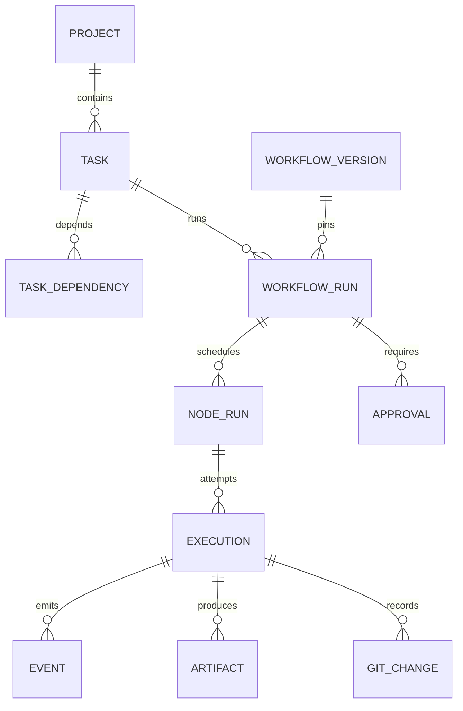

# Data model and storage

PostgreSQL is authoritative; UUID identifiers, UTC timestamps, optimistic `revision` and explicit foreign keys apply throughout. JSONB holds versioned validated payloads, not arbitrary executable code. Secrets are references to local stores, never table values. No schema/migration is implemented by the current scaffold.

| Aggregate | Fields / invariants |
| --- | --- |
| Project | id/name, canonical ext4 repo path, default ref, root allowlist, registered checks, policy version; unique canonical repo path |
| Task / TaskDependency | project/parent/title/description/criteria/status/priority/revision; no self/cross-project dependency; acyclic DAG; delete only before run references |
| AgentDefinition / AgentConfigVersion | role/provider/model/prompt/skill/tool/MCP refs/limits; immutable version/hash |
| WorkflowDefinition / WorkflowVersion | editable draft, immutable version/schema/graph/hash; unique (workflow_id,version) |
| WorkflowRun | workflow/plan/config/policy snapshots, root_base_sha, thread_id=run_id, controls/deadline/status/integration state |
| NodeRun | run/node/attempt/status; unique (run_id,node_id,attempt), bounded attempts |
| Execution | UUID, node attempt/operation/provider/worker/epoch/expiry, worktree/ref/root and execution base SHA, process/session metadata, deadlines, tree/commit/exit/results; one active writer per worktree |
| GitChange / GitOperation | task/execution/branch/base/tree/commit SHA and journalled intent; unique authoritative execution commit; integration application dedup key |
| Approval | snapshot hash, action/request revision/policy/expiry/decision/actor; one immutable decision |
| WorkerRegistration | stable worker identity, allowed roots, versioned capabilities, last heartbeat, running execution identities; no credential material |
| Artifact | run/execution/kind/media type/size/SHA-256/opaque storage key/redaction version; server-generated paths |
| Event | UUID/run monotonic sequence/type/time/trace/execution/epoch/payload; unique producer sequence, bounded payload |
| Command / Outbox / Inbox | stable ID, payload hash, pending/delivered/applied; unique command/effect key, replay safe |
| Policy / Skill / McpServerDefinition | immutable policy/manifests/hashes, command IDs, trusted locations/scopes/timeouts; secret references only |

Usage stores `source`, optional input/output tokens/cost/currency and `is_complete`; null means unknown, not zero. Session identifiers/logs require redaction and retention rules. Exit 0 alone does not imply accepted changes.

## Ownership and transactions

API owns definition CRUD and command intake. Orchestrator owns execution scheduling/state/checkpoints. Worker requests lease/event/result writes through API. Shared execution transitions use one versioned persistence layer or DB function contract deployed by API migrations; do not duplicate inconsistent state logic across services. Internal API applies fenced execution updates atomically, then emits outbox consumed by orchestration. API read models expose scheduler state without authoring it directly.

Logical schemas: `control` (definitions/commands/approvals), `runtime` (runs/ledger/outbox/events), `checkpoints` (LangGraph), `audit`. Migrator owns DDL; API and orchestrator get explicit grants; worker has no DB account. Langfuse uses an entirely separate database stack.

API repo owns a single Alembic migration chain for ADF tables and role grants. Orchestrator owns compatible checkpointer setup in its schema through migration coordination. E1 startup runs migrator exactly once before services; advisory migration lock and `service_completed_successfully` gate. Back up before upgrades; additive expand/contract migrations keep pinned old/new versions compatible. Never `create_all` as production migration.

## Retention and artifacts

Proposed defaults: operational logs 7 days, redacted events/traces 30 days, review/test/diff artifacts 30 days, accepted Git commits retained until user removal. Failed/uncertain worktrees stay until explicit preservation/cleanup review. Approval/audit records outlive executable artifact retention. Quota failure stops further dispatch; deletion runs only on terminal records with referential checks. Logs cap 20 MiB/execution, total run disk 5 GiB including worktrees/artifacts (Git shared object accounting documented during runtime implementation).

Uploads stream bounded data, verify size/checksum, reject symlinks/traversal and atomically move temp objects. API downloads only authorized registered keys with safe content type and attachment disposition; no raw HTML execution. Backup manifest binds DB snapshot, Git refs and artifact checksums. Restore test must demonstrate referential consistency, not merely successful file copy.
