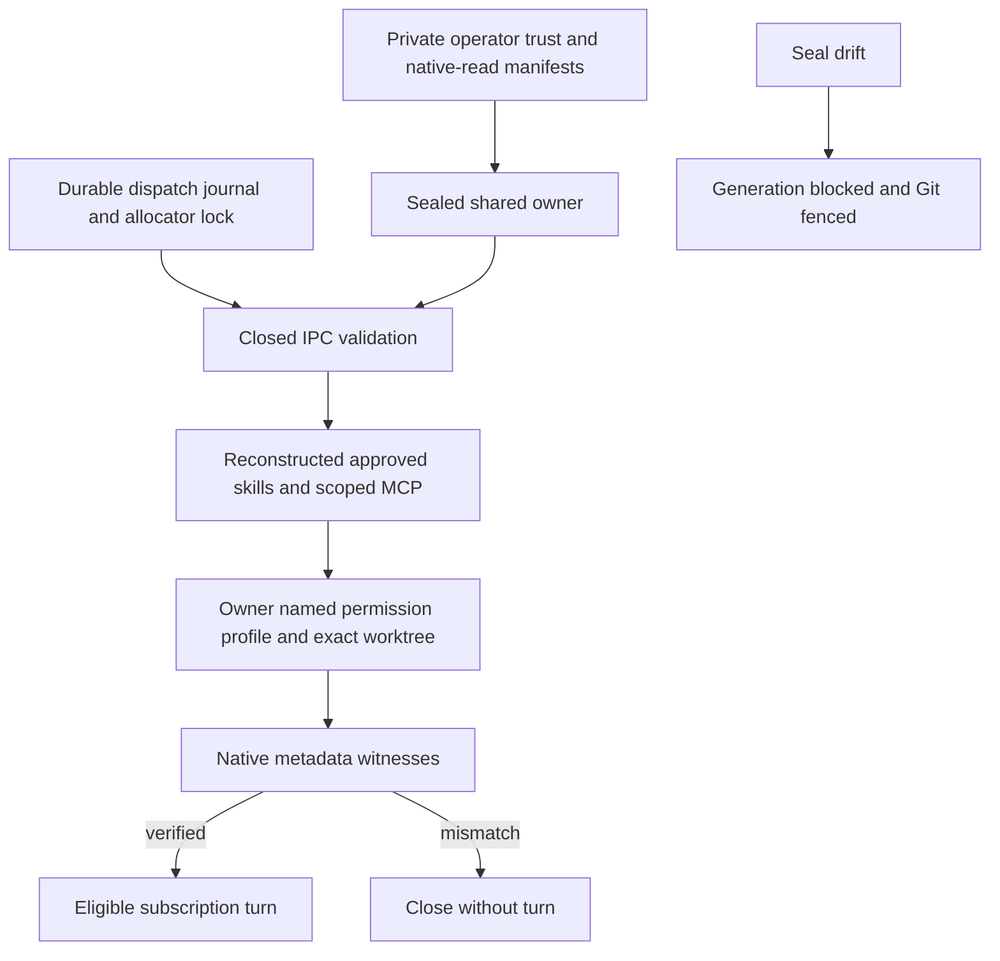

# Shared native read policy: source delivery and deployment boundary

October 11, 2026. This release changes worker source only. It does not install a worker, create an operator manifest/profile, change authentication or restart runtime services. Installed worker `13c4624a8791fa4c9035c284a4689e412f0b7b42` remains the retained runtime; the dedicated provider-server and consumer remain stopped. Readiness remains false.

## Current result and the legacy failure

The legacy Codex `read-only` sandbox prevents writes but permits full host reads. The diagnostic baseline read synthetic external files, Codex/Claude authentication canaries and both worker configuration canaries. **That legacy native preflight FAILED.** Earlier shared-policy and shared-patch source results do not supersede this failure.

The new source binds an operator-owned named native permission profile to the closed shared IPC. Its synthetic source canary passes actual pinned native metadata and command probes, including selected skills and scoped MCP registration. It uses no actual native model turn, API/Redis acceptance run or real authentication. These are distinct results. [Sanitized evidence](evidence/shared-native-read-source-2026-10-11.json), [worker implementation details](../services/runtime-worker/docs/native-read-policy.md) and [ADR 009](adr/009-operator-owned-native-read-policy.md) define their limits.

## Authority and dispatch

The owner requires two independent operator inputs: the existing sealed trust policy and a new private native-read manifest. Neither is supplied by an execution request. The owner defaults to an empty native filesystem with public platform/runtime read grants; it adds only the allocator-verified literal worktree for a particular thread. It supplies no writable or network grant. Job permission/config overrides are rejected before upstream thread creation.

The selected named profile has no inherited permissions. After validating the original closed client frame, the owner removes the legacy `sandbox` field, injects its named permission config, disables permission escalation features and disables provider-model fallback. It verifies the pinned response's active profile, exact runtime workspace root, cwd, approval policy, provider and read-only/network metadata before permitting a turn. Missing or unexpected witnesses close the thread without a turn.

The owner reconstructs skills/MCP from the durable dispatch journal through the same approval and tool-narrowing function used by the executor. Approved instruction documents are hash-checked, read-only and exact-path selected. Private metadata is masked by exact bounded traversal, preserving only approved skill ancestors and masking their siblings. The scan reads names/stat metadata, does not follow links or read private contents, and refuses more than 50,000 entries. Selected instruction-only skills do not grant scripts or additional tool roots.

MCP is the existing ADF-owned credential-free `adf.scoped-files.v1` server. Its worktree, approved paths, single-link files, byte/time quotas, tools and empty inherited env list are independently validated. Native permissions do not sandbox arbitrary MCP servers; those remain unsupported. New consumers refuse legacy owners before materializing configuration or starting the bridge.

The native manifest/root identity seal joins existing generation, allocation and Git receipts. Drift blocks the generation, interrupts siblings and fences later commits/copies. Accepted execution IDs remain non-replayable across owner restart. Unproven quiescence remains uncertain; locks and artifacts are retained. Existing guarded patch application, checker, independent review and serial integration remain unchanged.



## Source verification

The real-IPC canary uses temporary Git allocations, private fake profiles and copied public Codex/bwrap binaries whose hashes and source metadata are checked. An outer namespace mounts synthetic roots and public runtimes only, with no real home/profile/configuration or host sockets. Three ADF IPC jobs run concurrently; one is cancelled and siblings complete. The protocol double owns lifecycle turns; actual Codex receives only initialize, thread/start, skills/list, mcpServerStatus/list and thread/unsubscribe. Actual ThreadStartParams/Response are validated against its generated experimental schema.

Actual native command probes read the assigned marker and selected SKILL.md; outside/profile/configuration canaries, sibling worktrees, unapproved skill siblings, nested private files, hardlinks, symlinks, parent traversal and proc aliases are denied. Writes and command networking are denied. The actual native skill catalog enables only the selected instruction; the actual thread MCP inventory contains only `read_marker`. Tool invocation by a model is not tested here. Fake-owner tests separately cover refresh ownership, crash/restart without replay, drift, subscription-type rejection and forged capability/permission inputs.

Linux static/module checks and the complete suite are required locally and in CI. CI supplies the exact public binary hashes and runs the native canary; it has no model/authentication step. Independent source review is separate from runtime acceptance. SPEC, dependency pins, API/orchestrator/web source and existing runtime settings are unchanged.

## Exact future deployment scope; not executed

1. Select the exact published worker commit and matching umbrella pin. Preserve immutable installed `13c4624a` source, package/file inventory and stopped-service rollback proof. Verify API active leases, Redis pending ownership and local writer/session locks before a coordinated switch. Unknown ownership stops deployment.
2. Inventory proposed public tool roots recursively: no auth, configuration, mutable project files or secrets. The native manifest seals only root identity and manifest bytes, not every descendant. Approve an exact private manifest under the existing runtime `tools` directory, mode 0600, owned by `adf-worker`. The only required native CLI grant is its verified public vendor directory; approve any additional public tool directory separately.
3. Install only the reviewed worker into the existing worker venv, preserving dependency versions, identity and settings. Preserve the existing trust manifest/profile bytes. Add only the new native-read manifest and the owner `--shared-native-read-policy` flag; retain `--shared-profile-policy`. Do not modify login state, personal profile config or security policy as a workaround.
4. Update only the dedicated ADF provider-server and consumer as one drained release. Retain their existing root, API/Redis credentials, worker identity, project roots and explicitly approved backend. This release does not authorize switching to shared-patch, adding its checker manifest, replacing other services or performing a login.
5. Run an independently approved bounded subscription/API/Redis acceptance including three jobs, isolated skills/MCP/settings, single-job cancellation, owner/consumer failure and no paid API fallback. Keep readiness false until the defined gates pass. Stop on an unexplained private-layer mutation or lost quiescence proof.
6. On failure, drain or prove writers stopped before rollback. Restore the verified old worker only in a stopped safe state: legacy full-host reads remain a failed security gate and must not be resumed as accepted execution.

Example operator-owned manifest (template only; do not apply without exact inventory approval):

```json
{"version": 1, "read_tool_roots": ["/home/adf-worker/ai-factory/tools/provider-cli/lib/node_modules/@openai/codex/node_modules/@openai/codex-linux-x64/vendor/x86_64-unknown-linux-musl"]}
```

The matching owner invocation adds both private manifest flags; see the [worker startup contract](../services/runtime-worker/docs/native-read-policy.md). No Windows changes, users/groups, firewall, network listeners, global Git settings, API settings or unrelated service changes belong to this scope.

## Remaining limits

Private runtime root, selected profile and operator HOME under the listed public/denied system trees (or `/`) are rejected before manifest reads.

This is a trusted same-UID host design. A hostile host process can mutate mounts, worktree contents or operator tool descendants between checks. Exact deny masks are a bounded snapshot; runtime generation fencing is conservative but not an atomic filesystem barrier. Public platform directories selected by pinned `:minimal` remain readable; `/etc`, `/usr/local`, `/nix`, `/run` and `/mnt` are explicitly denied. The operator must classify public contents and accept that boundary.

The command sandbox and metadata/capability paths above are verified. Complete native built-in tool execution, code mode, model-selected MCP/skills and browser/web/apps routes are not exercised by this canary. Shell permission profiles do not imply isolation of those routes. Host `fs/readFile` RPC has no thread policy and is not exposed by the closed ADF IPC. Arbitrary servers, tool-script roots, Node/build checks and untrusted multi-process execution remain outside this release. Fake refresh/recovery results are not subscription-token refresh or live queue recovery acceptance.

## Primary technical sources

- [Codex permissions documentation](https://learn.chatgpt.com/docs/permissions) and [configuration reference](https://learn.chatgpt.com/docs/config-file/config-reference), inspected October 11, 2026; named filesystem/network profiles and their route limitations.
- [Pinned rust-v0.157.0 source](https://github.com/openai/codex/tree/rust-v0.157.0): app-server thread processor, filesystem permissions, Linux bwrap mount/mask construction, features and tool handlers. The actual CLI's generated experimental schema is committed in the worker; public schema alone lacks some required response witnesses.

The wire fields, feature keys and Linux behavior were checked against the pinned source, generated schema and actual metadata/command experiments. No unsupported native API is claimed.
