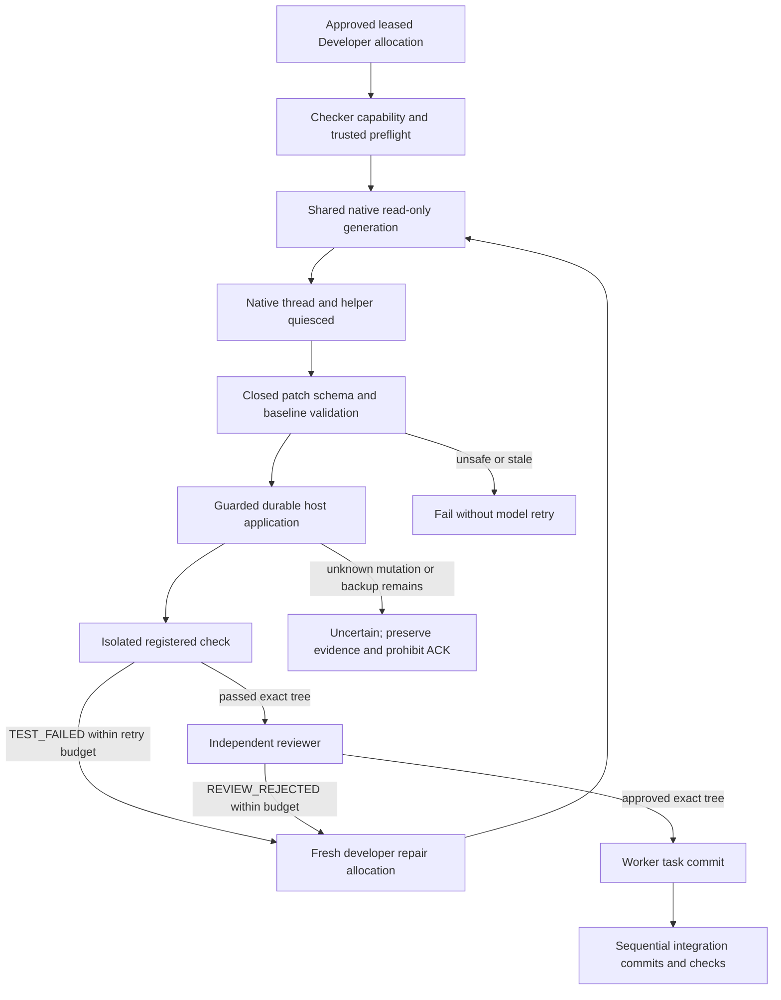

# Shared-patch source implementation

October 11, 2026. The opt-in worker backend implements the bounded path proposed in [the original investigation](shared-write-path.md). Runtime installation and native acceptance have not happened. Installed worker stays `13c4624a8791fa4c9035c284a4689e412f0b7b42`; provider/consumer stay stopped, auth/manifest/security policy are unchanged, and readiness remains false. [ADR 008](adr/008-shared-patch-and-isolated-checks.md) records the checker decision and remaining limitations.

## Completeness against SPEC

| Required behavior | Source implementation and evidence |
| --- | --- |
| Three independent developers | Shared owner remains one process; each generation uses a native read-only request and its own leased worktree. Offline regression concurrently applies three fake structured outputs in three real Git allocations. This is not native acceptance. |
| Check and repair loop | Existing orchestrator `TEST_FAILED`/`REVIEW_REJECTED` retries create a fresh bounded developer attempt, preserve child task scope, retest and return to independent review. Worker now reports `TEST_FAILED` explicitly for a failed registered check. Repair transfer uses the same guarded writer; it does not mutate the previous attempt. |
| Independent exact-tree review | Test receipt and reviewer identity/config bind the staged tree; self-review and changed trees stay rejected. A reviewer receives no writer authority. |
| Task commit and serial integration | Worker commits only after trusted passing checks and independent review. Integration applies task commits sequentially onto `factory/integration/<run-id>`, runs checks again, and leaves main unchanged. Existing Git crash/idempotency gates remain mandatory. |
| Safe subprocess checks | Separate operator-pinned Python checker uses an empty namespace, no host fallback/lock FD, private bounded scratch and readonly source/toolchains. A no-project-code resource/namespace preflight precedes model generation. Unsupported Node/build checks fail explicitly. |
| Cancellation/recovery/ACK | Writer checks live control before application, atomic mutation and destructive backup cleanup. Durable intents classify pre/postimages. Unknown/auxiliary state blocks later operations, terminal success and stopped/reconciliation proof, so no ACK. No recovery replay of a model turn. |
| Skills/MCP | Original approved instruction skills and read-only `adf.scoped-files.v1` remain unchanged. Live skill/MCP plus patch-generation acceptance is pending; offline schema/adapter tests do not prove model behavior. |

## Contract, authority and bounds

`adf.text-patch.v1` is internal to the worker, not a new API permission or MCP contract. The durable operator-selected backend/manifest are copied into supervisor tickets; model output cannot select either. Original approved repository/policy, developer role, epoch, allocation lock identity and write scope bind the writer. Lease margin, wall deadline, cancellation and the existing sealed profile/marker receipt are rechecked by the authoritative guard. The provider stage is observe only; it never turns an observe planner/reviewer into a host writer.

Closed JSON fields are `version: 1`, `edits`, and each edit's `path`, `action`, `preimage`, `content`. Create requires absent/null preimage, replace/delete require a supplied existing SHA-256; delete content is null. Duplicate JSON keys/paths and extra fields are rejected. Limits: 16 files, 32 KiB content per file, 48 KiB aggregate content and 60 KiB UTF-8 serialized result. The worker supplies trusted hashes in the generation prompt and checks them again before mutation. This does not ask the model to calculate hashes. Existing parent directories only; unsupported edits fail rather than invoking arbitrary commands.

The normalizer retains a bounded private structured result. Provider output audit events retain at most 4,096 characters so JSON escaping fits the existing 64 KiB API event limit; no wire/event limit was raised. The original execution-wide output budget still applies. Known secret scanning happens before writer intents, and no secret values are placed in durable bindings.

## Durable phases and recovery

Generation completion is `patch_generated`, an intermediate state without terminal success. Each application key has patch hash, original authorization binding, monotonic sequence and file records. Phases are `validated -> preparing -> prepared -> mutated -> applied`; each pre/postimage records inode/device/hash/mode/size, with a worker-generated sibling auxiliary name. Fsynced journal intents precede mutations. File data, target directory and journal updates are fsynced at their respective boundaries.

Create uses atomic no-replace. Replace exchanges the target with a prepared file, preserving the old inode in the auxiliary; delete atomically quarantines the target with no-replace. Captured old and new images must match the durable record. The writer never discards an unknown raced preimage. A current guard is required again before backup cleanup.

An identical already-applied intent is classified without rewriting files. Changed patch/binding raises `IDEMPOTENCY_CONFLICT`. A later repair/development intent can supersede an earlier image only through a verified pre/postimage chain. Recovery is **read-only classification**, not a transaction resume command: a proven no-write preimage or completed latest postimage with no auxiliary can be reconciled; prepared create is recognizable from the recorded new inode. Prepared replacement/deletion with an auxiliary, crash before an auxiliary's inode receipt, any unknown image or foreign edit remains `EXECUTION_UNCERTAIN`. Preserve it and use a separately reviewed manual reconciliation; do not delete auxiliaries, rerun a model or finish remaining writes automatically.

Cancellation before application writes nothing. Cancellation between completed files stops new edits and classifies the known partial state; it cannot become success. Cancellation/lease/policy change after exchange and before backup cleanup retains the auxiliary and remains uncertain. `ExecutionSupervisor` fences its terminal result with mutation proof, `stopped_proof` fences API reconciliation and consumer ACK, and the executor fences subsequent checks/review/commit/integration against an unresolved target. Safety/conflict/schema/resource errors are explicitly non-retryable in the orchestrator; ordinary test/review failure retains the existing bounded repair loop.

## Verification and scope

Offline regressions include the actual shared-patch adapter's observe conversion/schema/original-budget preservation, durable stopped proof and intermediate generated phase; hostile JSON/paths/content, create/replace/delete/modes, hardlinks/symlinks, concurrent preimage preservation, exact delivery, crash windows, cancellation and cleanup guard drift, unresolved reconciliation, and real namespace canaries for external synthetic auth, readonly source/root/dev, host network and inherited descriptors. The real Git pipeline runs three developers, intentionally fails the first check, applies a fresh repair, retests, independently reviews all trees, commits and serially integrates with passing final checks and unchanged main.

No model/native acceptance, login, setup-token, paid API, installed package/dependency upgrade, profile/manifest modification or service restart belongs to this verification. Final exact source commits/CI and installed-runtime inventory evidence are recorded in the [source release checkpoint](shared-patch-source-checkpoint.md). Node/build support and native read isolation remain explicit gates, not successful outcomes.
